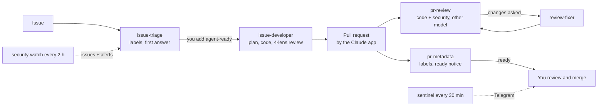

<p align="center">
  <picture>
    <source media="(prefers-color-scheme: dark)" srcset=".github/assets/logo-dark.svg">
    
  </picture>
</p>

<h1 align="center">agent-crew-harness</h1>

<p align="center">
  <b>A crew of Claude Code agents that runs your repository like a full tech and business team.</b><br>
  Triage · development of approved issues · reviews · CI diagnosis · security watch · hotfix lane · you stay in control
</p>

<p align="center">
  <a href="https://github.com/exceev-consulting/agent-crew-harness/actions/workflows/ci.yml"></a>
  <a href="https://github.com/exceev-consulting/agent-crew-harness/releases/latest"></a>
  <a href="LICENSE"></a>
</p>

<p align="center">
  <a href="docs/architecture.md">Docs</a> ·
  <a href="https://github.com/exceev-consulting/agent-crew-harness/discussions">Discussions</a> ·
  <a href="ROADMAP.md">Roadmap</a> ·
  <a href="CONTRIBUTING.md">Contributing</a> ·
  <a href="SECURITY.md">Security</a>
</p>

A crew of Claude Code agents that runs your repository like a full tech and business team, in a harness that keeps you
in control. The routines maintain a GitHub repository with you: they triage issues, develop the ones you approve,
review every pull request, answer review comments, resolve conflicts, diagnose CI failures, watch new CVEs in what your
project depends on, and run a hotfix lane for blocking bugs. You stay in control: nothing is written without your label,
nothing is merged or released without you.

It grew out of a real project (a Bash tool that secures servers) where these routines opened, reviewed and fixed dozens of
pull requests. Every routine here carries the rules that project learned the hard way. The harness maintains its own
repository with its own routines.

**Status:** 0.1.0, early. Linux only for now (the watchdog uses systemd). Claude Code desktop app with scheduled tasks.

## How it works



- **Routines** are Claude Code scheduled tasks, one prompt each, in `routines/<name>/`. They run unattended on your
  machine, on their own schedule.
- **Ground rules** shared by all routines live in [`core/RULES.md`](core/RULES.md): who they act as, what is untrusted,
  where they may write, what they never do.
- **Your project** is described once in `PROFILE.md` ([spec](docs/profile.md)): what it is, what must never run on the
  machine, the CI checks, labels, conventions. Every routine reads it each run, so the routines stay generic.
- **Helpers** in [`bin/`](bin) do what a script should decide, with tests: the GitHub App identity (`bot-gh`), the
  private-data guard (`scan-private`), Telegram (`notify`), the sentinel's plan (`sentinel-scan`), the CVE collector
  (`security-watch`), the watchdog that runs outside Claude (`harness-watchdog`), the renderer and the doctor.
- **Two keys.** A routine writes code only for an issue you labelled `agent-ready` or `ready`. It posts as a GitHub App,
  never as you. It never merges, tags or pushes to your default branch.

## The routines

| Routine | Default schedule | What it does |
|---|---|---|
| issue-triage | daily | First answer, labels, duplicates, milestones, issue fields |
| issue-developer | every 4 h | One `agent-ready` issue per run: plan, implement, review through four lenses, open a PR |
| pr-review | 4 times a day | Code and security review by a different model than the one that wrote the code |
| review-fixer | 4 times a day | Fixes what reviewers asked, replies in each thread |
| conflict-fixer | every 3 h | Merges the default branch into conflicting PRs, resolves, re-runs the checks |
| pr-metadata | every 3 h | Labels, review requests, milestone, board, and one "ready for you" notice per PR |
| ci-doctor | every 2 h | Diagnoses failures of the long CI workflow: caused by the PR, flaky or infrastructure |
| bug-hunter | weekly | Reviews one area of the code per week, files proven bugs |
| bug-fixer | twice a week | Fixes one bug a maintainer or the harness filed (off by default) |
| market-research | weekly | Watches users, upstreams and competitors, opens up to 2 proposals |
| feature-planner | twice a week | The product owner: specifies market-research proposals and ideas you label `needs-spec` (user story, acceptance criteria, sub-issues), and proposes missing features weekly. Never code |
| sentinel | every 30 min | Telegram and desktop alerts: critical issues, advisories, "do not merge", red default branch, failing routines |
| hotfix-developer | every 30 min | Develops a `priority: critical` issue at once, once you add `agent-ready` |
| hotfix-review | hourly | Reviews critical pull requests at once |
| security-watch | every 2 h | New CVEs from GitHub advisories, OSV (Debian/Ubuntu), NVD and CISA KEV for your components |
| status-board | twice a day | Refreshes the status board, a Claude artifact page: what needs you, PRs, issues, milestones, CI, tests, routine health |

Each routine has a version (`routine.json` and the last line of its prompt). The installer records what you installed
and shows what an update changes.

Routines use well-known Claude Code skills where they fit: `code-review` and `security-review` as extra lenses in
reviews, `simplify` on a routine's own diff before it commits.

## Install

Requirements: Linux with systemd, the Claude Code desktop app (scheduled tasks), `git`, `gh` (logged in), `jq`,
`curl`, `python3`, `openssl`, `node`.

```bash
git clone https://github.com/exceev-consulting/agent-crew-harness.git ~/src/agent-crew-harness
```

Or install only the skills as a Claude Code plugin (Claude Code 2.1.275 or later):

```text
/plugin install agent-crew-harness --marketplace exceev-consulting/agent-crew-harness
```

Open Claude Code in that folder, in a session with Bypass permissions (scheduled tasks keep the mode of the session that
creates them), and ask:

> Install the harness for my repository.

The `harness-install` skill walks you through it: settings, the two GitHub Apps (one page each, a click on GitHub), the
private-data guard, your `PROFILE.md` (the `harness-profile` skill drafts it from your repository), labels, Telegram,
the routines you want, the watchdog, and a final check by `harness-doctor`. Nothing is written to GitHub or your system
without your yes.

To update later: `git pull`, then ask Claude Code to update the harness. It shows the routine versions that change.

## Docs

- [Architecture](docs/architecture.md): how routines, rules, profile, helpers and state fit together.
- [Security model](docs/security-model.md): what an agent can and cannot do, and why.
- [Profile](docs/profile.md): the sections of `PROFILE.md`. Examples: [server-prep](profiles/server-prep/PROFILE.md),
  [this repository](profiles/agent-crew-harness/PROFILE.md).
- [Hotfix lane](docs/hotfix-lane.md), [Security watch](docs/security-watch.md), [Status board](docs/status-board.md), [Telegram](docs/telegram.md),
  [Labels](docs/labels.md), [Writing a routine](docs/routine-format.md), [Maintaining this repository with itself](docs/self-hosting.md).

## License

MIT. See [LICENSE](LICENSE).
