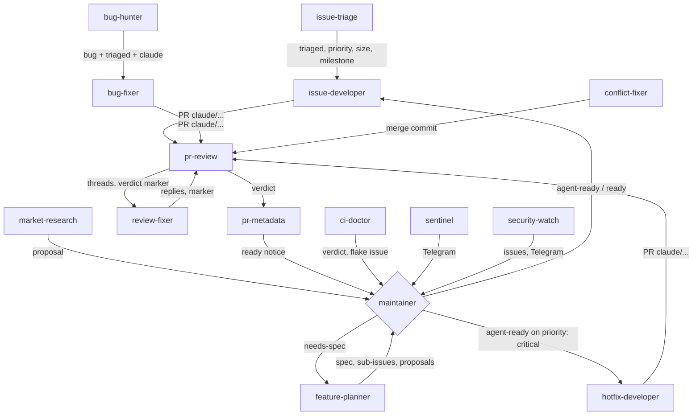

# Architecture

## Pieces

| Piece | Where (repository) | Where (install) | Role |
|---|---|---|---|
| Ground rules | `core/RULES.md` | `<harness_dir>/RULES.md` | What every routine may and may not do. Rendered with your settings. |
| Profile | `profiles/<name>/PROFILE.md` | `<harness_dir>/PROFILE.md` | Facts of your project. Written by you (or drafted by `/harness-profile`). |
| Routines | `routines/<name>/SKILL.md` + `routine.json` | `<tasks_dir>/<task_prefix><name>/SKILL.md` | One scheduled task each. Rendered, then created through the app. |
| Workflow | `workflows/develop-issue.js` | `<harness_dir>/workflows/` | Multi-agent script the developers run in ultracode mode: understand, plan, implement, review through four lenses, fix, verify. |
| Helpers | `bin/`, `lib/` | `<harness_dir>/bin`, `lib` | Deterministic parts, with tests in `tests/`. |
| Settings | `harness.example.json` | `<harness_dir>/harness.json` | Identity: repository, paths, people, app names. |
| Feature settings | `config/*.example.json`, `profiles/<name>/*.json` | `<harness_dir>/sentinel.json`, `security-watch.json` | Data for the sentinel and the security watch. |
| Secrets | none | `<secrets_dir>` | App keys, Telegram token, private-data patterns. Never read by a prompt. |
| State | none | `<harness_dir>/state`, `locks`, `worktrees`, `tmp` | What routines remember between runs. |
| Watchdog | `lib/systemd/*.in` | `~/.config/systemd/user/<task_prefix>watchdog.*` | Runs outside Claude every 15 minutes. |

## A run

1. The app starts the scheduled task at its time (if the app is open; a missed slot runs when it opens).
2. The prompt tells the run to read `RULES.md` and `PROFILE.md`.
3. Gate routines (hotfix-developer, hotfix-review) first ask a helper whether there is work, and stop in seconds when not.
4. The routine works in its own git worktree, claims an issue or pull request with a lock directory, and writes to GitHub
   only through `bot-gh` / `review-gh` (a GitHub App token, the private-data guard on every post).
5. It leaves markers in its comments and lines in `state/` so the next run, and other routines, can pick up.
6. It ends with a short summary, visible in the app's run list.

## Handoffs between routines

Unattended runs cannot start other scheduled tasks: the app refuses `run_scheduled_task` without a person present. So
urgency comes from schedules (every 30 minutes for the hotfix lane), not from one routine waking another.

## Why scripts for some decisions

A prompt is good at judgement (is this bug real, does this fix fit) and weak at bookkeeping (what did I already notify,
which run is two hours late). Bookkeeping lives in helpers with tests: `sentinel-scan` computes the sentinel's plan and
remembers what it sent; `security-watch` collects and deduplicates CVEs; `harness-watchdog` decides what is stale. The
prompt carries out the plan.
