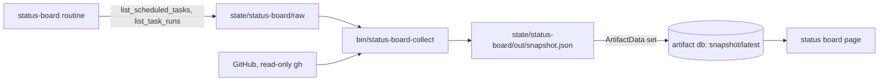

# Status board

The status board is one page that shows where your repository and its routines stand: what needs you now, open pull
requests and who each one waits on, issues and milestones, CI, test results, and every routine's health and recent runs.
It is a Claude artifact (a private page on claude.ai) with a small database. The page reads one document,
`snapshot/latest`; the `status-board` routine rewrites that document twice a day.



## What it shows

| Part | What | From |
|---|---|---|
| Status | ok, attention or critical, and the list of what needs attention, most urgent first | everything below |
| Pull requests | open PRs, checks, review label, conflicts, and who each one waits on (you, the author, the co-maintainer, CI) | `gh pr list` |
| Issues | open issues by type and priority, the queues (`agent-ready`, `needs-info`, `status: blocked`, `proposal`, high-priority bugs), milestones and their release signal | `gh issue list`, milestones |
| CI | pass rate per workflow over 7 days, the latest run of each workflow on the default branch, recent runs; workflows marked required in the settings come first | `gh run list` |
| Tests | only when the settings have a `tests` block: the end-to-end results by system and scenario, new failures, flaky tests, history, analytics, and the step history of one CI workflow | the tests workflow's artifacts |
| Routines | every scheduled task whose id starts with `task_prefix`: health (ok, failed, missed, running, paused), runs over 7 days, last result | the routine's saved task lists |
| Overview | activity over 14 days, what changed since the last refresh, a trend of open PRs, issues and warnings (about 3 months) | the previous snapshot |

What raises attention:

- **critical**: a required workflow fails on the default branch (any workflow when none is marked required); the tests
  workflow fails on the default branch; a test regression on the default branch; a routine's last run failed (a usage
  limit is only a warning); a PR labelled `review: do not merge`; a milestone with nothing open and something closed
  since the last release (release it, then close the milestone).
- **warning**: another workflow fails on the default branch; a scheduled run was missed; the issue developer gave up on
  an issue (`locks/issue-<n>.failed`); failing checks on a PR; PRs waiting for CI approval; PRs waiting on you for 3
  days or more; 5 or more routine PRs open (the issue developer pauses); a blocked issue; a milestone where only merges
  remain; a test regression on another branch; check steps failing in their latest run.
- **note**: PRs waiting on you, proposals waiting for `ready`, unreleased changes and a release 7 days old or more,
  flaky tests, and any source the collector could not read.

The milestone release signal is the same for every milestone, whatever its name: "done" when no issue is open and at
least one closed after the latest release, "developed" when every open issue has an open pull request (from its branch
name: `fix-12`, `claude/feat-12-...`, `issue/12`...), "released" when everything closed before the latest release.

Routine summaries and errors, lock notes and task titles go through `bin/scan-private` first: text it refuses becomes
`[hidden: mentions private infrastructure]`. Artifacts of test runs are written by pull request code: they are read as
JSON data only (symbolic links are ignored, 5 MB and string lengths capped). The snapshot stays under 250 KB (the
store refuses documents over 256 KiB): passing assertions are dropped first.

## Settings: `status-board.json`

In `harness_dir`, next to `bin/`. Start from [`config/status-board.example.json`](../config/status-board.example.json);
complete examples: [server-prep](../profiles/server-prep/status-board.json),
[this repository](../profiles/agent-crew-harness/status-board.json). Without the file the collector uses the defaults
and says so on the board.

| Key | Default | Meaning |
|---|---|---|
| `timezone` | `UTC` | IANA name. Days of the activity charts, the morning/evening slot, the next refresh. Use the machine's timezone: the routine's cron runs on local time. |
| `refresh_times` | `["08:30", "19:30"]` | When the routine runs (`HH:MM` in `timezone`), for "next refresh". Keep it in line with the task's schedule. |
| `changelog` | `CHANGELOG.md` | File on the default branch whose `## [Unreleased]` section counts unreleased changes (`- ` lines). `null`: none. |
| `release_workflow` | none | Workflow file the release links open (`release.yml`); without it they open the releases page. |
| `ci.workflows` | `[]` | `[{"name", "file", "required"}]`: `name` is the workflow's display name as runs show it. Required workflows come first and make the board critical when red on the default branch. |
| `ci.show_other_workflows` | `true` | `false`: show only the workflows listed. |
| `tests` | none | The test results, below. Without it the snapshot has no `tests` or `e2e` block and the page hides the Tests tab. |

`tests`:

| Key | Meaning |
|---|---|
| `workflow` | Workflow file of the tests (`e2e.yml`). |
| `name` | Short name shown on the board (default: the file). |
| `artifact_prefix` | Each run uploads one artifact per system named `<prefix><system>` (`e2e-vm-debian-12`): the system name is what follows the prefix. |
| `results_file` | The results file inside each artifact (`results.json`). |
| `format` | `scenarios-v1`, the only format supported (below). |
| `ignore_jobs` | Jobs of the workflow that are not a system (`setup`, `report`). A system job with no results counts as "missing". |
| `checks_workflow` | Workflow whose steps are tracked one by one (default: the first required CI workflow). |
| `description` | One sentence shown above the end-to-end matrix. |
| `report` | Optional HTML report links: `url` (base), `main` (path for the default branch), `pr` (path for a pull request, `{pr}` is its number). |

The collector keeps at most the 20 latest finished test runs and 25 check runs of the last 30 days, and caches each
parsed run in `state/status-board/cache/` so an artifact is downloaded once.

### The `scenarios-v1` results format

One JSON object per system. Only `scenarios` is required; unknown keys are ignored.

```json
{
  "os": "debian-12",
  "label": "Debian 12",
  "status": "passed",
  "duration_s": 367,
  "accel": "kvm",
  "kernel": "6.1.0",
  "reason": "",
  "counts": {"passed": 13, "failed": 0, "skipped": 0},
  "scenarios": [
    {"id": "install", "title": "Installs on a fresh system", "group": "core", "status": "passed", "duration_s": 120,
     "reason": "", "assertions": [{"name": "exits 0", "ok": true, "detail": ""}]}
  ],
  "audit": {
    "before": {"pass": 18, "warn": 12, "fail": 5, "info": 4, "score": 68},
    "after": {"pass": 48, "warn": 0, "fail": 0, "info": 5, "score": 100}
  },
  "steps": [{"label": "firewall", "second": "OK"}]
}
```

- `status` of the file: `passed`, anything else counts as failed. A scenario's `status`: `passed`, `failed` or
  `skipped` (anything else counts as failed). `id` identifies a scenario across runs and systems.
- `audit` (optional): a score per stage of the run, stages in order, at most 6. The board shows them in a "Scores by
  stage" table, the first stage as the neutral starting point.
- `steps` (optional): a step whose `second` value starts with `CHANGED` or `FAIL` is listed as "what the second run
  changed", for tools that must be idempotent.
- Limits: 60 scenarios per system, 80 assertions per scenario, strings cut to 60 to 200 characters.

## Build and publish (once, by the installer)

```bash
cd <harness repository>/status-board/app && pnpm install --frozen-lockfile
cd .. && HARNESS_CONFIG=<harness_dir>/harness.json ./build.sh
```

`build.sh` writes `status-board/dist/status-board.html`, titled "<project> Status Board", and
`status-board/dist/preview.html`, a full page that fakes the database with a local snapshot
(`--snapshot FILE`, default `<harness_dir>/state/status-board/out/snapshot.json`) to check the page in a browser.

Then, in a Claude Code session with the user present, publish `status-board/dist/status-board.html` with the Artifact
tool and the `db` capability (load the `artifact-capabilities` and `artifact-design` skills first, as the Artifact tool
asks). Save the artifact's URL in `harness.json` as `status_board_artifact`, and create the `status-board` routine. The
routine reads the URL at run time (`lib/harness.sh`, `hconf status_board_artifact`); until it is there, every run stops
with "status board not published yet".

To update the page later: rebuild and publish the same file to the same URL. The data stays: it lives in the database,
not in the page.

## Run the collector by hand

```bash
<harness_dir>/bin/status-board-collect
```

It needs `state/status-board/raw/tasks.json` and `runs-<taskId>.json` files saved by the routine (without them the Routines
tab is empty and the board says why), reads GitHub with your `gh` login, read-only, and writes
`state/status-board/out/snapshot.json` (the previous one becomes `previous.json`). It never writes the artifact: the routine
does. Tests: `tests/status-board.sh` (fake GitHub data, no network).
